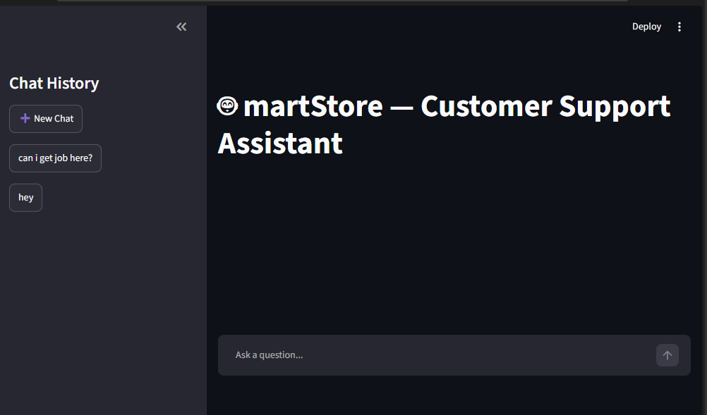
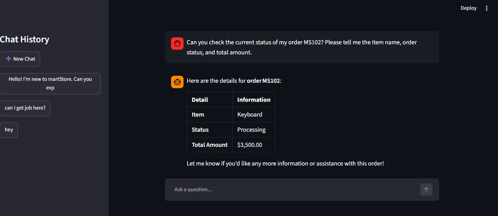
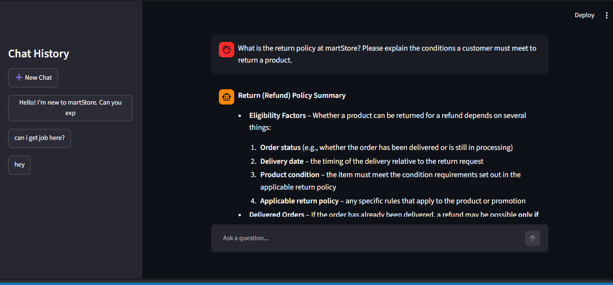
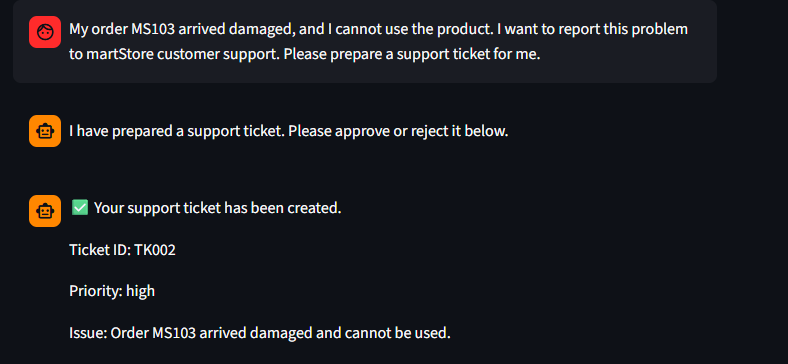
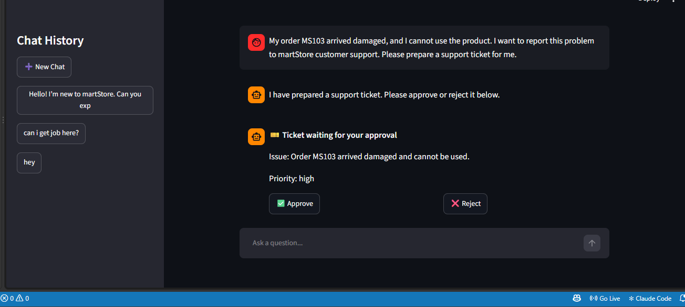

🤖 martStore AI Support Assistant
An AI-powered customer-support assistant that answers store-policy questions using Retrieval-Augmented Generation (RAG), retrieves order information from a database through tool calling, and prepares support tickets for human approval.
Project detail	Information
Hackathon	NYLP AI Hackathon 2026
Developer	Rafia Shaikh — Solo participant
Project status	Working prototype; runs locally with Streamlit
Architecture	Single-agent application with multiple workflow paths

- GitHub repository: https://github.com/rafiashaikh00/martstore-ai-support-assistant
- Demo video: https://drive.google.com/file/d/1AWLPAVSrBFewreGHvq9q_5v9l56Jlm46/view?usp=drive_link
Table of Contents
- Overview
- Problem Statement
- Proposed Solution
- Target Users
- Key Features
- Application Screenshots
- How It Works
- Technology Stack
- AI Methodology and Implementation
- AI Models and APIs Used
- Project Structure
- Setup and Installation
- Run the Application
- Example Questions
- Current Scope and Limitations
- Individual Team Contributions
- Development Tools Used
- Challenges Faced and Lessons Learned
- Future Improvements
- Additional Documentation
- Information for Judges
Overview
martStore AI Support Assistant is a customer-support prototype built with Python, Streamlit, LangChain, and LangGraph. It routes customer requests to the workflow best suited to the task: general conversation, policy question answering, order lookup, or support-ticket preparation.

The application combines a language model with retrieval from policy documents, a SQLite-backed order lookup tool, persistent conversation state, and a human approval step for support tickets. It is a single-agent application with multiple workflow paths, not a multi-agent system.
Problem Statement
Online stores receive recurring questions such as “What is your return policy?”, “Where is my order?”, and “How can I report a damaged item?” Small support teams may not be able to answer every request immediately. A generic chatbot may also give unreliable answers if it cannot access the store’s actual policy documents or order records.

This project explores how AI can help with routine first-line support while grounding policy answers in documents, retrieving order details from stored data, and keeping support-ticket creation under human control.
Proposed Solution
Instead of treating every message as a generic chat question, the assistant routes requests to the relevant workflow.
Customer request	Workflow	Intended result
General question or greeting	General chat	A conversational answer from the language model
Return, shipping, or refund question	Policy RAG	An answer informed by retrieved policy text, with source filenames where available
Order ID or order-status question	Order lookup tool	Order information retrieved from SQLite rather than guessed by the model
Complaint or product problem	Human-in-the-loop ticket workflow	A proposed support ticket that a person can approve or reject

The goal is to reduce repetitive support work without allowing the assistant to independently cancel, modify, or refund orders.
Target Users
- Online-store customers who need quick answers about store policies or order status.
- Small e-commerce support teams that want to streamline routine questions while retaining human oversight for support-ticket decisions.
Key Features
- Intent-based routing: directs requests to general chat, policy RAG, order lookup, or ticket handling.
- Policy question answering with RAG: retrieves relevant content from text-based policy documents and can identify source filenames.
- Order lookup through tool calling: retrieves order details from SQLite.
- Human-in-the-loop ticketing: pauses the ticket workflow for human approval or rejection.
- Conversation history: provides a chat interface for working with multiple conversations.
- Persistent graph state: uses SQLite-backed LangGraph checkpointing to support conversation persistence and resuming, according to the configured workflow.
- Streaming responses: progressive response display where implemented in the application.
- Bounded actions: supports information lookup and ticket preparation; it does not independently cancel, change, or refund orders.
Application Screenshots
The screenshots below are stored in the repository’s image/ directory. The folder name and filenames must match these paths exactly because GitHub paths are case-sensitive.
## 📸 Application Screenshots
### Dashboard

### Home

### Order Lookup

### Policy RAG

### Support Ticket Approval

### Human-in-the-Loop — Ticket Rejected

How It Works
Main workflow
Customer message
       |
       v
Intent router
       |
       +---- general ----> General chat node ------------------+
       |                                                       |
       +---- policy -----> Policy node -> RAG pipeline --------+
       |                                                       |
       +---- order ------> Order node <-> Order lookup tool     +--> Response
       |                         |                             |
       |                         v                             |
       |                    SQLite order data                  |
       |                                                       |
       +---- ticket -----> Prepare ticket -> Human approval ---+
                                      |               |
                                  Approve            Reject
                                      |               |
                                  Save ticket      Do not save
Policy RAG pipeline
polices/*.txt
     |
     v
Load policy documents
     |
     v
Split text into chunks
     |
     v
Create embeddings with Hugging Face Sentence Transformers
     |
     v
Store vectors in ChromaDB
     |
     v
Retrieve relevant chunks for a customer question
     |
     v
Generate an answer grounded in retrieved context
Technology Stack
Layer	Technology	Purpose
Programming language	Python	Application logic and integrations
Frontend	Streamlit	Chat interface, conversation navigation, and approval controls
Workflow orchestration	LangGraph	Workflow nodes, conditional routing, state, and human-in-the-loop flow
LLM framework	LangChain	Model integration, prompts, and tools
Runtime language-model API	Groq API	Provides access to the configured language model
Language model	openai/gpt-oss-120b	Language generation and model-supported workflow tasks in the current project configuration
Embeddings	Hugging Face Sentence Transformers	Converts policy chunks into vectors for semantic retrieval
Embedding model	sentence-transformers/all-MiniLM-L6-v2	Creates vector embeddings for policy-document retrieval
Vector store	ChromaDB	Stores and searches embedded policy chunks
Relational storage and checkpointing	SQLite	Stores demo order data and supports configured persistence/checkpointing
Policy knowledge base	Text files in polices/	Supplies store-policy content for retrieval

AI Methodology and Implementation
1. Intent routing
The backend routes a customer request to an appropriate workflow. Depending on the request and the configured routing logic, the workflow can direct the message to general conversation, policy retrieval, order lookup, or ticket preparation. This separates the application’s capabilities instead of treating every request as the same kind of question.
2. Retrieval-Augmented Generation (RAG)
The RAG pipeline in data_rag.py loads policy text files from polices/, splits the documents into chunks, creates embeddings, and stores them in ChromaDB. For a policy question, the retriever searches for relevant chunks and provides that context to the language model to help produce an answer grounded in the store’s documents. Source filenames can be included so users can identify the documents used.
3. Order lookup through tool calling
For order-related requests, the workflow can call an order-lookup tool that reads the configured order data from SQLite. The assistant uses the retrieved result to explain the order information instead of inventing order status or item details.
4. Human-in-the-loop ticket handling
When a customer reports a problem, the workflow prepares a support-ticket summary and pauses for a human decision. The reviewer can approve or reject the proposed ticket through the interface. This keeps ticket creation under human oversight.
5. Conversation state and persistence
The application uses LangGraph state and SQLite-backed checkpointing to preserve conversation state by thread, according to the configured persistence workflow. This supports separate conversations and resuming saved state.
AI Models and APIs Used
Model, API, or component	Provider	Role in the project
openai/gpt-oss-120b	Groq API	Runtime language model configured for response generation and supported workflow tasks
sentence-transformers/all-MiniLM-L6-v2	Hugging Face Sentence Transformers	Embedding generation for semantic retrieval of policy text
ChromaDB	Open-source vector database	Stores and retrieves policy embeddings
LangChain and LangGraph	Open-source frameworks	Connect the language model, tools, workflow routing, state, and approval flow
Claude AI	Anthropic	Development assistance for explanations, coding guidance, and debugging; not a runtime model unless the application calls Claude’s API

The application needs access to a Groq API key to run the language model. The key is a private credential: it should be configured locally and must never be pasted into this README or committed to GitHub. Do not include any real API key in the repository.
Project Structure
.
├── data_fron.py        # Streamlit frontend and chat interface
├── data_back.py        # LangGraph backend, routing, tools, and workflow logic
├── data_rag.py         # Policy loading, embeddings, retrieval, and RAG answers
├── polices/            # Policy text documents used by RAG
├── image/              # Screenshots displayed in this README
│   ├── dashboard.png
│   ├── home.png
│   ├── order.png
│   ├── poilicy.png
│   ├── ticket.png
│   └── ticket_human_loop_reject.png
├── requirements.txt    # Python dependencies
├── .env                # Local secret configuration; do not commit
└── README.md           # Project documentation
Runtime database and vector-store files depend on the application’s configuration. Do not commit secrets or real customer information.
Setup and Installation
Prerequisites
- Python installed on your computer.
- Git, if cloning the repository.
- A Groq API key for running the configured language model.
1. Clone the repository
git clone https://github.com/rafiashaikh00/martstore-ai-support-assistant.git
cd martstore-ai-support-assistant
2. Create and activate a virtual environment
Windows PowerShell:
python -m venv .venv
.venv\Scripts\Activate.ps1
If PowerShell blocks activation, use Command Prompt instead:
.venv\Scripts\activate.bat
macOS / Linux:
python3 -m venv .venv
source .venv/bin/activate
3. Install dependencies
pip install -r requirements.txt
4. Configure the Groq API key locally
The application needs a valid Groq API key to call the configured language model. Configure the key on your own computer using the method supported by your local setup. Do not put the key in this README, screenshots, source code, or a public GitHub commit. Keep secret configuration files out of version control.
Run the Application
From the project root, with the virtual environment active, run:
streamlit run data_fron.py
Streamlit should display a local URL in the terminal and open the application in your browser. Follow any first-run setup or policy-indexing messages shown by the app.
Example Questions
The order IDs below refer to example/demo data and work only if those records exist in the local database.
Example prompt	Expected workflow
Hello! I'm new to martStore. How can you help me?	General chat
What is the return policy at martStore?	Policy RAG with retrieved policy context
Can you check the status of order MS102?	SQLite order lookup tool
My order MS103 arrived damaged. Please prepare a support ticket.	Ticket preparation followed by human review
Please reject this proposed support ticket.	Rejection path when a ticket is awaiting a decision

Current Scope and Limitations
- This is a working prototype, not a complete production customer-support platform.
- The application runs locally; no public live deployment is claimed here.
- Order lookup depends on the demo data configured in SQLite.
- The assistant does not independently cancel, modify, or refund orders.
- Ticket creation is designed to require a human approval decision.
- Answer quality depends on the policy documents and retrieval quality.
- Streaming and persistence behavior depend on the features implemented and enabled in the current code.
- The prototype should not be connected to real customer data without authentication, privacy controls, and appropriate security safeguards.
Individual Team Contributions
This is a solo project. Rafia Shaikh is responsible for the project’s design, implementation, integration, testing, and documentation, including:
- Building the Streamlit chat interface and conversation navigation.
- Implementing the LangGraph workflow and request-routing logic.
- Integrating the configured language model through the Groq API.
- Building the policy RAG pipeline with text documents, embeddings, and ChromaDB.
- Implementing SQLite-backed order lookup and configured conversation persistence.
- Adding the human-in-the-loop support-ticket approval/rejection flow.
- Testing the main workflows and preparing screenshots and project documentation.
Claude AI was used as a development assistant for explanations, coding guidance, and debugging support. It is listed as a development tool, not as a runtime application model unless Claude API calls are present in the project code.
Development Tools Used
- Visual Studio Code
- Python and virtual environments
- Git and GitHub
- Streamlit
- Groq API
- LangChain and LangGraph
- ChromaDB and Hugging Face Sentence Transformers
- SQLite
- Claude AI for development assistance
Challenges Faced and Lessons Learned
Developing the project involved learning how to connect multiple components into one customer-support workflow. Key learning areas included:
- Routing customer requests to different workflows instead of using a single generic response path.
- Retrieving relevant policy passages and using them to inform AI-generated answers.
- Combining natural-language interaction with structured order data from SQLite.
- Managing workflow state and persistent conversations.
- Pausing a workflow for human approval before saving a support ticket.
- Configuring API access securely and documenting setup steps.
The project provided practical experience with agentic workflow design, RAG, tool integration, state management, and human oversight in an AI application.
Future Improvements
- Record and publish a short end-to-end demo video.
- Deploy a stable public demo if suitable hosting is available.
- Add automated tests for routing, retrieval, order lookup, and ticket approval/rejection.
- Improve structured logging and user-facing error messages.
- Expand the policy knowledge base and evaluate retrieval quality with a test set.
- Add authentication, role-based access, and privacy safeguards before using real customer or order data.
Additional Documentation
- GitHub repository: https://github.com/rafiashaikh00/martstore-ai-support-assistant
- Demo video: ADD_DEMO_VIDEO_LINK_WHEN_READY
- Additional documentation: No separate report or presentation link is provided.
Information for Judges
martStore AI Support Assistant demonstrates how a customer-support application can combine conversational AI, document retrieval, database-backed order lookup, and human review in a single-agent architecture. It is a working local prototype developed as a solo project for the NYLP AI Hackathon 2026.

The repository includes the source files, policy documents, dependency list, and screenshots referenced in this README. The demo-video link will be added after the walkthrough has been recorded and uploaded.
